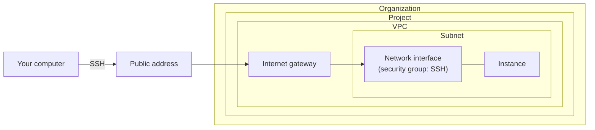

# Get started with Origin Cloud

This tutorial takes you from a new user account to a running Linux instance you log in to over SSH. You register your organization in the console, add a payment method through the GraphQL API, and use the `origin` CLI for everything else.

## What you'll build

You'll end up with an organization that holds one project. In the project is a VPC with one subnet that reaches the internet through an internet gateway. In the subnet runs one instance, with a public IPv4 address and a security group that admits SSH.

The following diagram shows the end state.



## What you'll learn

- How to install the CLI, log in and set your defaults.
- How to register an organization and read its review status.
- How to create a project and add a payment method.
- How to build a network that reaches the internet.
- How to import a key pair, launch an instance and log in to it.
- How to remove what you created.

## Before you begin

- An Origin Cloud user account.
- A Linux or macOS computer with `ssh`, `ssh-keygen` and `curl`.
- Your company's billing details: postal address, invoice email address, contact person and, outside Germany, a VAT identification number. The billing address must be in an EU member state.
- A credit or debit card for the payment method.

## Cost

The instance, its boot volume and its public IPv4 address are billable for as long as they exist. Registering an organization, creating a project and the network cost nothing. If you follow [Clean up](#clean-up) right after the tutorial, you pay for a few minutes of usage. For current rates, see [Pricing](../../pricing/index.md).

## Step 1: Install the CLI and log in

1. Install the `origin` CLI. See [Install the CLI](../access/cli.md#install-the-cli).

2. Log in. Your browser opens the Origin Cloud login page:

   ```sh
   origin id login
   ```

   On a machine without a browser, use `origin id login --device` instead. See [Log in](../access/cli.md#log-in).

3. Choose the zone to work in, and make it your default. List the zones, then set one, for example `eu-central1-az1`:

   ```sh
   origin location list-zones
   origin config profile-set default-zone eu-central1-az1
   ```

   The commands of this tutorial then work in that zone, and in its region, `eu-central1`. See [Set a default project, zone and region](../access/cli.md#set-a-default-project-zone-and-region).

## Step 2: Register your organization

1. Register the organization with its billing details in the console. You're then the organization's Owner and its billing administrator.

2. Find the organization's id, the last segment of its `name`, for example `0a1b2c3d4e5f`:

   ```sh
   origin resourcemanager list-organizations
   ```

For details and the other ways to create an organization, see [Create an organization](../organizations/create.md).

## Step 3: Check the review status

1. Read the organization's state:

   ```sh
   origin resourcemanager get-organization --organization <organization-id>
   ```

2. Check `state`:

   - `ACTIVE`: continue with the next step.
   - `PENDING_REVIEW`: the platform operator reviews the organization. You get an email when it's approved. Continue with steps 4 to 6 in the meantime; step 7 on needs an active organization.
   - `REJECTED`: the decision is final, and you can't continue.

For what each state allows, see [Organization review status](../organizations/review-status.md).

## Step 4: Create a project

1. Create a project, under an id you choose: 6 to 16 lowercase letters, digits and hyphens, starting with a letter:

   ```sh
   origin resourcemanager create-project --organization <organization-id> \
     --project-id getting-started --display-name "Getting started"
   ```

2. Make it your default project:

   ```sh
   origin config profile-set default-project getting-started
   ```

   The following steps leave out `--project`, `--zone` and `--region`, and work in this project, your default zone and its region.

## Step 5: Add a payment method

A new project is charged to your organization's default billing account. Launching an instance is refused with [`PAYMENT_METHOD_REQUIRED`](../reference/errors.md#payment_method_required) until that billing account has a verified payment method.

1. Follow [Add a payment method](../billing/payment-method.md) for your project. You start the setup through the API, enter the card on the payment provider's page, and confirm it through the API.

2. Verify that the billing account's `paymentMethodStatus` is `VERIFIED`.

## Step 6: Create a key pair

The instance accepts SSH logins only with the key pair you name at launch. In this step you create a key on your computer and import its public half.

1. Create a key on your computer:

   ```sh
   ssh-keygen -t ed25519 -f ~/.ssh/origin-getting-started -C getting-started
   ```

2. Import the public key into your project:

   ```sh
   origin compute create-key-pair \
     --public-key "$(cat ~/.ssh/origin-getting-started.pub)" \
     --tag origin:name=getting-started
   ```

3. Note the key pair's id, the last segment of its `name` in the output.

The private key never leaves your computer. To have the platform generate a key pair instead, see [Create a key pair](../../compute/key-pairs/create.md).

## Step 7: Build the network

An instance's network interface lives in a subnet. For the instance to be reachable from the internet, the subnet's VPC needs an internet gateway, the subnet a route to it, and the interface a security group that admits SSH and a public address, a Floating IP. Each command waits until its change is recorded and prints the new resource; note the id from each `name`.

1. Create a VPC:

   ```sh
   origin network create-vpc --tag origin:name=getting-started
   ```

2. Create a subnet in it:

   ```sh
   origin network create-subnet --vpc <vpc-id>
   ```

3. Create the VPC's internet gateway:

   ```sh
   origin network create-internet-gateway --vpc <vpc-id>
   ```

4. Create a route table, add a default route to the gateway, and associate the table with the subnet:

   ```sh
   origin network create-route-table --vpc <vpc-id>
   origin network create-route --route-table <route-table-id> \
     --destination 0.0.0.0/0 --internet-gateway <internet-gateway-id>
   origin network create-route-table-association --subnet <subnet-id> \
     --route-table <route-table-id>
   ```

5. Create a security group, and allow SSH in and all traffic out:

   ```sh
   origin network create-security-group --vpc <vpc-id> --tag origin:name=ssh
   origin network create-security-group-rule --security-group <security-group-id> \
     --direction INGRESS --protocol TCP --first-port 22 --cidr-block 0.0.0.0/0
   origin network create-security-group-rule --security-group <security-group-id> \
     --direction EGRESS --protocol ALL --cidr-block 0.0.0.0/0
   ```

6. Create the instance's network interface in the subnet, and put it in the security group:

   ```sh
   origin network create-network-interface --subnet <subnet-id>
   origin network create-security-group-association \
     --network-interface <network-interface-id> \
     --security-group <security-group-id>
   ```

7. Allocate a Floating IP, a public IPv4 address, and associate it with the interface. Note the Floating IP's `address`:

   ```sh
   origin network create-floating-ip
   origin network create-floating-ip-association --floating-ip <floating-ip-id> \
     --network-interface <network-interface-id>
   ```

   If the allocation is refused, the public IP quota may be used up. See [Limits](../reference/limits.md#network).

For what each part does, see [Create a VPC and subnets](../../network/vpcs/create.md).

## Step 8: Launch an instance

1. Choose an instance type. Pick one whose `available` is `true`, for example a small one such as `gp1.core.2`:

   ```sh
   origin compute list-instance-types
   ```

2. Choose an image family, such as an Ubuntu release. Pick one whose `available` is `true`, and note its id, the last segment of its `name`:

   ```sh
   origin compute list-image-families
   ```

3. Launch the instance. The command waits until the instance is `RUNNING`, and prints it:

   ```sh
   origin compute create-instance \
     --instance-type gp1.core.2 \
     --image-family <image-family-id> \
     --key-pair <key-pair-id> \
     --network-interface <network-interface-id> \
     --tag origin:name=getting-started
   ```

4. Note the instance's id and its `loginUser` in the output.

   Example output (illustrative):

   ```json
   {
     "name": "projects/getting-started/zones/eu-central1-az1/instances/i-WsGD79fcM9y",
     "instanceType": "instanceTypes/gp1.core.2",
     "loginUser": "cloud",
     "state": "RUNNING",
     "interfaceAddresses": [
       {
         "networkInterface": "projects/getting-started/zones/eu-central1-az1/networkInterfaces/nic-OFNeQKPRn3l",
         "ipv4Address": "10.0.0.5",
         "ipv6Address": "2001:db8::5"
       }
     ]
   }
   ```

If the launch is refused, the error tells you why. For example, `INSUFFICIENT_CAPACITY` means no machine has room for that type right now; try a smaller type or try again later. If the instance ends up `FAILED`, its `stateReason` says why. See [Error codes](../reference/errors.md).

## Step 9: Connect to the instance

Logins need the key pair's private key; passwords are refused.

1. Find the instance's public address, the Floating IP's `address` from step 7:

   ```sh
   origin network get-floating-ip --floating-ip <floating-ip-id>
   ```

2. Log in as the instance's `loginUser`, with the private key from step 6:

   ```sh
   ssh -i ~/.ssh/origin-getting-started cloud@<public-address>
   ```

3. Verify that you're on the instance. The login user has passwordless `sudo`:

   ```sh
   sudo whoami
   ```

   Example output (illustrative):

   ```text
   root
   ```

## Clean up

Remove what you created so it stops costing money. Each delete needs `--yes`, because it can't be undone.

1. Terminate the instance. Its boot volume is deleted, and its network interface becomes available again:

   ```sh
   origin compute delete-instance --instance <instance-id> --yes
   ```

2. Delete the key pair:

   ```sh
   origin compute delete-key-pair --key-pair <key-pair-id> --yes
   ```

3. Release the Floating IP. Remove its association first, then the address; list the association to find its id:

   ```sh
   origin network list-floating-ip-associations --floating-ip <floating-ip-id>
   origin network delete-floating-ip-association --floating-ip <floating-ip-id> \
     --association <association-id> --yes
   origin network delete-floating-ip --floating-ip <floating-ip-id> --yes
   ```

4. Delete the network, in this order. Deleting the subnet also deletes its route table association and its unattached network interface, with the interface's security group association:

   ```sh
   origin network delete-subnet --subnet <subnet-id> --yes
   origin network delete-route-table --route-table <route-table-id> --yes
   origin network delete-security-group --security-group <security-group-id> --yes
   origin network delete-internet-gateway --internet-gateway <internet-gateway-id> --yes
   origin network delete-vpc --vpc <vpc-id> --yes
   ```

To delete the project as well, see [Manage projects](../organizations/projects.md#delete-a-project).

## Next steps

- [Compute](../../compute/index.md): instance lifecycle, images and instance types.
- [Storage](../../storage/index.md): add volumes and take snapshots.
- [Network](../../network/index.md): private subnets, NAT gateways and network ACLs.
- [IAM](../../iam/index.md): invite your team and assign roles.
- [Service accounts](../../iam/service-accounts.md): automate with the CLI and the API.
