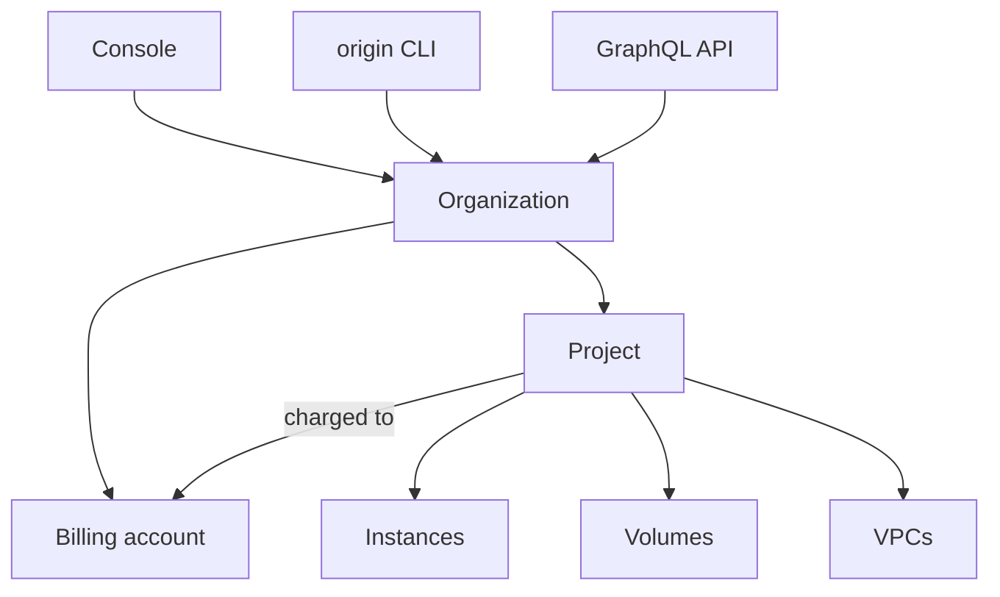

# What is Origin Cloud?

Origin Cloud is an infrastructure cloud: it runs virtual machines, block storage and private networks for you, so you don't buy or operate the hardware underneath. You create resources on demand, pay for what you use, and remove them when you're done. Every resource belongs to a project, and every project belongs to your organization.

The following diagram shows how your organization holds projects, how projects hold resources, and the three ways you reach them.

An **organization** is your company's account. It holds your members and their roles, your billing accounts, and your projects. A **project** groups the resources of one application or environment, and is charged to one billing account. A **resource** is anything you create in a project: an instance, a volume, a VPC, a security group and so on.

## Features

**Compute**  
Virtual machines, called instances, launched from an image at a size you choose. See [Compute](../compute/index.md).

**Storage**  
Durable block volumes and snapshots for your instances. See [Storage](../storage/index.md).

**Network**  
Private VPCs, internet access, Floating IPs, NAT gateways, security groups and DNS. See [Network](../network/index.md).

**DNS**  
Public and private hosted zones for your own domains, and their record sets. See [DNS](../dns/index.md).

**IAM**  
Members, roles, service accounts and the audit log of your organization. See [IAM](../iam/index.md).

**Observability**  
Metrics for your instances, volumes and network interfaces. See [Observability](../observability/index.md).

**Pricing**  
The public list price of every billable product. See [Pricing](../pricing/index.md).

**Organizations and projects**  
Your account, its review status, and the projects you create resources in. See [Organizations](organizations/index.md).

**Tags**  
Key-value labels, such as a name, on your network, compute and storage resources. See [Tags](tags.md).

**Support cases**  
Questions and problems you raise with Origin Cloud support, and the conversation about each. See [Support cases](support-cases.md).

**Billing**  
Billing accounts, payment methods, and who may manage them. See [Billing](billing/index.md).

## Ways to access Origin Cloud

**Origin Cloud console**  
The web interface, for working with your organization in a browser.

**`origin` CLI**  
A command-line tool for Linux and macOS that covers organizations, projects, compute, storage, network and IAM. See [Use the CLI](access/cli.md).

**GraphQL API**  
Every operation the console and the CLI use, at `https://graph.origincloudapis.eu/graphql`. See [Use the GraphQL API](access/api.md).

For a comparison, see [Ways to access Origin Cloud](access/index.md).

## Before you can create resources

Three things stand between a new organization and its first instance:

1. The organization must be `ACTIVE`. A new organization is either activated immediately or reviewed first. See [Organization review status](organizations/review-status.md).
2. The project's billing account needs a verified payment method before you create anything billable. See [Add a payment method](billing/payment-method.md).
3. Each organization has quotas on what it can hold at once. See [Limits](reference/limits.md).

## Pricing

Origin Cloud bills by usage. Each billable product has a public list price per unit, such as an hourly rate for an instance type or a rate per gigabyte of network traffic. See [Pricing](../pricing/index.md). For how your organization pays, see [Billing](billing/index.md).

## On origincloud.eu

[Origin Cloud](https://www.origincloud.eu/) describes the platform and its services, and [Cost management](https://www.origincloud.eu/cost-management/) how you follow and limit what you spend.

## Next steps

- [Get started with Origin Cloud](getting-started/index.md): register an organization and launch your first instance.
- [Reference](reference/index.md): CLI commands, error codes and limits.
