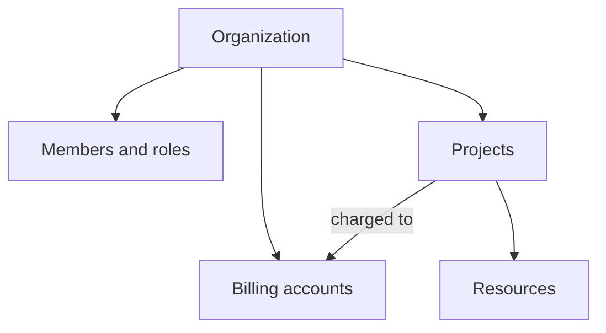

# Organizations and projects

An organization is your company's account on Origin Cloud. It holds the people and service accounts that can act in it, the billing accounts it pays through, and the projects your resources live in. You register an organization once; after that you work inside its projects.

The following diagram shows what an organization holds and how a project connects resources to billing.

## Key concepts

**Organization**  
Your company's account. It has a name, an ID such as `0a1b2c3d4e5f`, and a review status. Whoever creates it becomes its Owner. See [Create an organization](create.md).

**Review status**  
Whether the organization may create billable resources: `PENDING_REVIEW`, `ACTIVE` or `REJECTED`. See [Organization review status](review-status.md).

**Project**  
A container for the resources of one application, team or environment. Every instance, volume and VPC belongs to exactly one project. Roles can be granted on a single project. See [Manage projects](projects.md).

**Billing account**  
What a project is charged to. Every organization starts with one billing account, named `default`, and every project is linked to one. See [Billing](../billing/index.md).

**Members**  
The people and service accounts that hold a role in the organization. See [IAM](../../iam/index.md).

## What you can do

- [Create an organization](create.md)
- [Check your organization's review status](review-status.md)
- [Create, rename and delete projects](projects.md)
- [Add a payment method](../billing/payment-method.md)
- [Invite members and assign roles](../../iam/manage-members.md)

## Limits and quotas

Quotas apply per organization and, if you set budgets, per project. See [Limits](../reference/limits.md).

## Related

- [Billing](../billing/index.md)
- [IAM](../../iam/index.md)
- [Platform CLI commands](../reference/cli.md)
