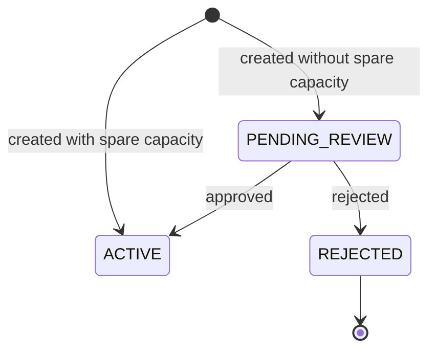

# Organization review status

Every organization has a review status that decides whether it may create billable resources. A new organization is either activated the moment you create it or placed under review, depending on how much spare capacity the platform has at that moment. You don't choose which, and there's nothing to opt into.

The following diagram shows the statuses and the transitions between them.



## Statuses

| Status | Meaning | Can create billable resources |
|---|---|---|
| `PENDING_REVIEW` | The organization waits for a decision by the platform operator. | No |
| `ACTIVE` | The organization is approved. | Yes, once its billing account has a payment method |
| `REJECTED` | The organization was rejected. The decision is final. | No |

The decision is the platform operator's. There's no way to approve your own organization, or to request a decision, through the console, the CLI or the API.

## What an organization under review can do

An organization under review can be administered normally. You can invite and remove members, assign roles, create service accounts, and manage billing accounts and payment methods.

What it can't do is create projects or resources that cost money. These operations check the status and are refused until the organization is `ACTIVE`:

- Create a project
- Launch an instance
- Create, import or grow a volume
- Create a snapshot
- Create a VPC, including the default VPC a first launch creates
- Allocate a Floating IP
- Create a NAT gateway

The refusal is a [`BAD_REQUEST`](../reference/errors.md#bad_request) error that names the `org_id` field, for example:

```text
invalid input on field org_id: organisation is pending_review, not active - it cannot create resources until an operator approves it
```

Being `ACTIVE` isn't the last check. Most of these operations also need a verified payment method on the project's billing account. See [Add a payment method](../billing/payment-method.md).

## Emails

The person who created the organization gets these emails:

1. When the organization is created: confirmation that the registration was received.
2. When it's approved, including an immediate activation: an approval email.
3. When it's rejected: a rejection email.

An organization created by a service account has no email address to notify, so no emails are sent.

## Check the status

Read the organization's status with the CLI, as its `state` field:

```sh
origin resourcemanager get-organization --organization <organization-id>
```

`origin resourcemanager list-organizations` shows the state of every organization you hold a role in. With the API, read `status` from the `organisation` or `organisations` query in the `admin` namespace.

## Related

- [Create an organization](create.md)
- [Add a payment method](../billing/payment-method.md)
- [Error codes](../reference/errors.md)
