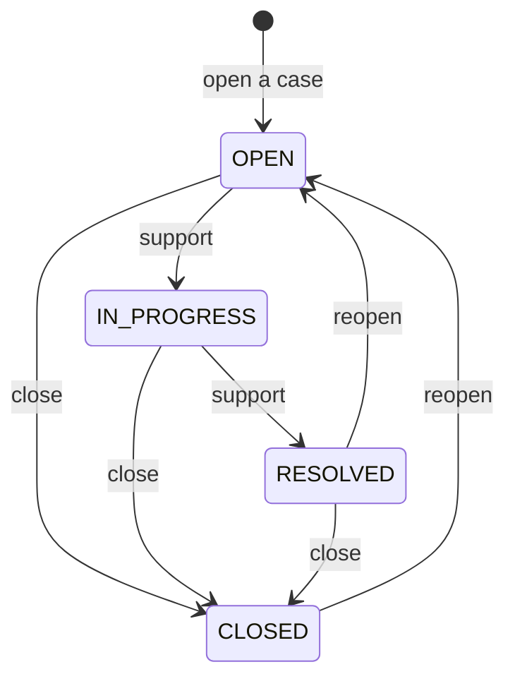

# Support cases

A support case is a conversation between your organization and Origin Cloud support about one question or problem. It belongs to your organization and can name one of its projects. Its messages are the conversation, oldest first, and a message can't be changed or removed once it's added.

## States

A case is always in one of four states. Support moves it between them as it works on the case, and you can close it or open it again yourself.

**`OPEN`**  
The case was opened, or opened again, and waits for support.

**`IN_PROGRESS`**  
Support is working on it.

**`RESOLVED`**  
Support considers it solved. Reopen it if it isn't.

**`CLOSED`**  
The case is finished. Reopen it to continue the conversation.

## Notifications

Every notification about a case goes to the contact email you give when you open it, for as long as the case exists. The address is sent a notification when someone other than the person who opened the case adds a message, and whenever the case's state changes. Nobody is emailed about their own messages.

## Permissions

Cases are governed by the `admin.support_case` permissions on the organization. See [Roles](../iam/roles.md).

| Permission | Lets you |
|---|---|
| `admin.support_case.list` | List the organization's cases. |
| `admin.support_case.get` | Read a case and its messages. |
| `admin.support_case.create` | Open a case and add messages to it. |
| `admin.support_case.update` | Close a case and open it again. |

## In the REST API

The support REST API answers at `https://support.origincloudapis.eu`. It's a preview (`v1beta1`): names and fields may still change. Every request carries an access token, as for the GraphQL API; see [Use the GraphQL API](access/api.md#authenticate).

A case is named `organizations/<org-id>/cases/<case-id>`, and a message `organizations/<org-id>/cases/<case-id>/messages/<message-id>`. A case about one project names it in `project` as `projects/<project-id>`; the project has to be one of the organization's.

| Method | HTTP | Does |
|---|---|---|
| `ListCases`, `GetCase` | `GET /v1beta1/organizations/<org-id>/cases`, `GET /v1beta1/organizations/<org-id>/cases/<case-id>` | The organization's cases, newest first. |
| `CreateCase` | `POST /v1beta1/organizations/<org-id>/cases` | Opens a case from its `subject`, `description`, `contactEmail` and, optionally, `project`. |
| `CloseCase` | `POST /v1beta1/organizations/<org-id>/cases/<case-id>:close` | Closes the case. Closing a closed case changes nothing and notifies nobody. |
| `ReopenCase` | `POST /v1beta1/organizations/<org-id>/cases/<case-id>:reopen` | Opens a resolved or closed case again. A case that is `OPEN` or `IN_PROGRESS` is left as it is. |
| `ListCaseMessages`, `GetCaseMessage` | `GET /v1beta1/organizations/<org-id>/cases/<case-id>/messages` | The case's messages, oldest first. |
| `CreateCaseMessage` | `POST /v1beta1/organizations/<org-id>/cases/<case-id>/messages` | Adds a message from its `body`. |

- Lists return a page at a time: 100 entries by default, at most 500 with `pageSize`. Pass the response's `nextPageToken` as `pageToken` for the next page.
- `CreateCase` and `CreateCaseMessage` take an optional `requestId`, a UUID. A retry with the same `requestId` within 24 hours returns what the first request created and creates nothing. The same `requestId` with a different request is refused with `CONFLICT`.
- A change's response carries an `Origin-Consistency-Token` header. Send it back with your next reads and they show the change; see [Read what you just changed](access/api.md#read-what-you-just-changed).

Setting a case to `IN_PROGRESS` or `RESOLVED` is support's, so the REST API has no method for it.

## Related

- [Use the GraphQL API](access/api.md)
- [Error codes](reference/errors.md)
- [Limits](reference/limits.md)
