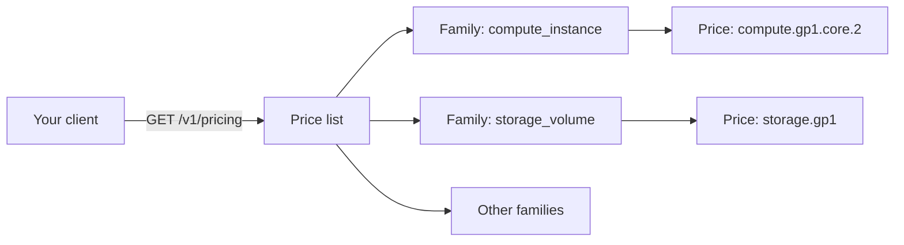

# What is Origin Cloud Pricing?

Origin Cloud publishes the current list price of every billable product in one public price list: instance types, volume storage classes, snapshots, Floating IPs, NAT gateways, network traffic, observability, and DNS. You read it over HTTP, without an account or an access token. Use it to estimate costs before you launch anything, or to show current prices on your own website.

## How the price list is organized

The following diagram shows how one request to the price list endpoint returns product families, each holding the prices for its products.

## Key concepts

**List price**  
The rate every organization is billed at unless it has agreed a different rate with Origin Cloud. The price list is read from the same price records that invoices are calculated from, so a published price and a billed one can't drift apart. A rate agreed for one organization is never shown in the list.

**Product family**  
A group of products that are billed the same way, such as `compute_instance` or `network_vpc_egress`. The list shows the families in a fixed order and leaves out a family that has no current price. See [Product families](reference/price-list-api.md#product-families).

**Product key**  
The identifier of what a price bills, for example `compute.gp1.core.2`, `storage.gp1`, or `network.vpc_egress`. Usage and cost reports use the same keys.

**Unit**  
Every price is `amount` euro per `unit_count` of `unit_type`. A `unit_count` of `3600` with `unit_type` `seconds` is an hourly rate. Traffic in `gb` is counted in decimal gigabytes (10^9 bytes). All amounts exclude VAT.

A product in the price list isn't necessarily available to order. Selecting a product that is priced but not on sale fails with [`PRODUCT_UNAVAILABLE`](../platform/reference/errors.md#product_unavailable).

## Ways to access Pricing

**HTTP**  
`GET https://billing.origincloudapis.eu/v1/pricing` returns the price list as JSON. See [Read the price list](read-price-list.md) and the [Price list API reference](reference/price-list-api.md).

The price list isn't part of the GraphQL API, and the `origin` CLI doesn't read it.

## Related services

- [Billing](../platform/billing/index.md) – how your organization pays for what it uses.
- [Instance types](../compute/instances/instance-types.md) – what each `compute_instance` price buys.
- [Storage classes](../storage/volumes/storage-classes.md) – what each `storage_volume` price buys.

## On origincloud.eu

[Origin Cloud services](https://www.origincloud.eu/cloud-services/) lists every service and whether you can use it yet. The rates for instances and volumes are on [Compute instance rates](https://www.origincloud.eu/compute/pricing/) and [Volume rates](https://www.origincloud.eu/pvs/pricing/).

## Next steps

- [Read the price list](read-price-list.md)
- [Pricing reference](reference/index.md)
