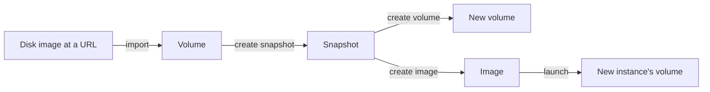

# What is Origin Cloud Storage?

Origin Cloud Storage provides durable block volumes for your instances and point-in-time snapshots of those volumes. A volume is a disk that keeps its data independently of any instance. A snapshot captures a volume's data so you can create new volumes or images from it. Most instances get their volumes automatically from their image at launch; this guide covers volumes and snapshots as resources you manage yourself.

## How the parts fit together

The following diagram shows how data moves between volumes, snapshots, and images, and how an imported disk image becomes a volume.

A snapshot becomes usable as a source only after you protect it. For the rules, see [Snapshot states](snapshots/snapshot-states.md).

## Features

**Volumes**  
Durable block disks that you create, import, resize, attach to instances, and delete. See [Volumes](volumes/index.md).

**Storage classes**  
Performance tiers for volumes. `gp1` (general purpose, SSD-backed) is the tier you can select. See [Storage classes](volumes/storage-classes.md).

**Snapshots**  
Point-in-time, crash-consistent copies of a volume, used as the source for new volumes and images. See [Snapshots](snapshots/index.md).

**Disk image import**  
Create a volume whose initial content is a disk image you download from an HTTP(S) URL. See [Import a disk image as a volume](volumes/import.md).

## Ways to access Storage

**Origin CLI**  
The `origin pvs` command group covers volumes, storage classes, and snapshots. See [`origin pvs` commands](reference/cli.md).

**GraphQL API**  
Volumes, snapshots, and storage classes live under the `pvs` namespace of the API. See [Storage reference](reference/index.md).

For installing the CLI and authenticating, see [Access Origin Cloud](../platform/access/index.md).

## Related services

- [Instance storage](../compute/instance-storage/index.md) – how an instance's own volumes are created at launch.
- [Attach and detach volumes](../compute/instance-storage/attach-detach.md) – connect a volume you created to an instance.
- [Create an image](../compute/images/create.md) – turn a protected snapshot into an image you can launch instances from.
- [Pricing](../pricing/index.md) – how volumes and snapshots are billed.

## On origincloud.eu

[Persistent Volume Storage](https://www.origincloud.eu/pvs/) describes the service, and [Volume rates](https://www.origincloud.eu/pvs/pricing/) lists the monthly rate per GiB.

## Next steps

- [Create a volume](volumes/create.md)
- [Create and protect a snapshot](snapshots/create-and-protect.md)
- [Troubleshoot storage](troubleshooting/index.md)
