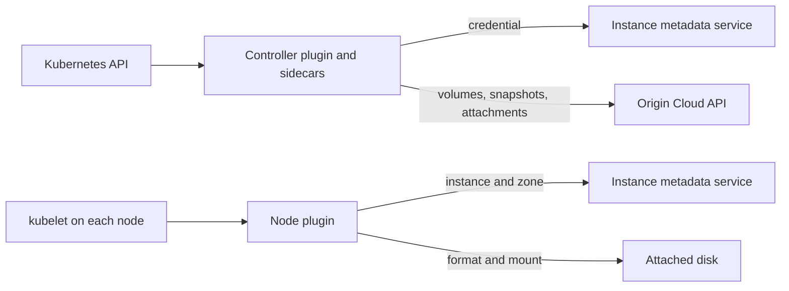

# Volumes for Kubernetes with the Origin CSI driver

The Origin CSI driver connects a Kubernetes cluster that you run on Origin Cloud instances to Storage. A `PersistentVolumeClaim` becomes a [volume](../volumes/index.md) in the zone of the node its pod runs on, a `VolumeSnapshot` becomes a [snapshot](../snapshots/index.md), and growing a claim grows the volume while the pod keeps running. The driver is the [Container Storage Interface](https://kubernetes-csi.github.io/docs/) driver `pvs.csi.origincloud.eu`, and its source and manifests are in the public repository [origincloudhq/csi-driver-origincloud](https://github.com/origincloudhq/csi-driver-origincloud).

The driver authenticates as the [service account the nodes' instances run as](../../compute/instances/service-account.md), through each instance's metadata service. No API key, token or Kubernetes `Secret` with an Origin Cloud credential is stored in the cluster.

## How the parts fit together

The following diagram shows the driver's two parts and what each one talks to.

- **The controller plugin** runs as one `Deployment` replica in `kube-system`, beside the Kubernetes CSI sidecars (provisioner, attacher, resizer and snapshotter). It creates, deletes, resizes and snapshots volumes, and attaches a volume to the instance of the node a pod is scheduled to.
- **The node plugin** runs as a `DaemonSet` on every node. It finds the attached disk by the volume's id, creates its filesystem the first time, mounts it for the pod and grows the filesystem after an expansion. It calls no API and needs no credential.

## Key concepts

**Storage classes and topology**  
Each Kubernetes `StorageClass` of the driver selects a Storage storage class. A volume lives in one zone and attaches only to an instance in that zone, so claims wait for their first pod and are created in its node's zone. See [Storage classes and topology](storage-classes.md).

**One node at a time**  
A volume attaches to one instance at a time. The driver supports the access modes `ReadWriteOnce` and `ReadWriteOncePod`, not `ReadWriteMany`. A node takes at most 24 of the driver's volumes.

**No credential in the cluster**  
The nodes run as a `WORKLOAD` service account that holds the built-in role [`roles/pvs.csi-driver`](../../iam/roles.md#rolespvscsi-driver), and nothing more is needed.

## What you can do

- [Install the Origin CSI driver](install.md) on a cluster you run on Origin Cloud instances.
- [Snapshot and restore a persistent volume](snapshots.md) with `VolumeSnapshot` objects.
- [Expand a persistent volume](expand.md) while its pod runs.
- [Troubleshoot the Origin CSI driver](troubleshooting.md).

## Limits

- A node takes at most 24 of the driver's volumes.
- A volume's size is a whole number of GiB, at least 1: the driver rounds a claim's size up.
- A volume never shrinks.
- The volumes and snapshots count against your project's [Storage quotas](../volumes/index.md#limits-and-quotas) and are billed like any other; see [Pricing](../../pricing/index.md).

## Related

- [Volumes](../volumes/index.md)
- [Snapshots](../snapshots/index.md)
- [Run an instance as a service account](../../compute/instances/service-account.md)
- [Built-in roles](../../iam/roles.md#rolespvscsi-driver)
