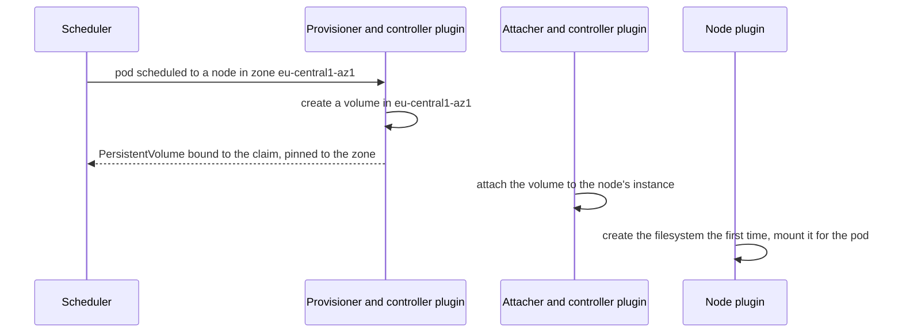

# Storage classes and topology

A Kubernetes `StorageClass` of the Origin CSI driver decides two things about the volumes its claims get: the [Storage storage class](../volumes/storage-classes.md) (the performance tier) and the filesystem. Where the volume is created follows from the pod that uses it: a volume lives in one zone and attaches only to an instance in that zone.

## The installed StorageClass

The [install manifests](install.md) create one `StorageClass`, `origin-gp1`, and make it the cluster's default:

```yaml
apiVersion: storage.k8s.io/v1
kind: StorageClass
metadata:
  name: origin-gp1
  annotations:
    storageclass.kubernetes.io/is-default-class: "true"
provisioner: pvs.csi.origincloud.eu
parameters:
  storageClass: //pvs.origincloudapis.eu/storageClasses/gp1
  csi.storage.k8s.io/fstype: ext4
volumeBindingMode: WaitForFirstConsumer
allowVolumeExpansion: true
reclaimPolicy: Delete
```

Only `gp1` has a `StorageClass`, because it's the only class you can select today (`available: true` in `origin pvs list-storage-classes`). A claim in a class that isn't available would never be provisioned.

| Setting | Value | Effect |
|---|---|---|
| `provisioner` | `pvs.csi.origincloud.eu` | The driver provisions the claims. |
| `volumeBindingMode` | `WaitForFirstConsumer` | The volume is created only once a pod using the claim is scheduled, in that pod's node's zone. |
| `allowVolumeExpansion` | `true` | A claim can grow; see [Expand a persistent volume](expand.md). |
| `reclaimPolicy` | `Delete` | Deleting the claim deletes the volume and its data. |

To keep another default class, or to keep volumes after their claim is deleted (`reclaimPolicy: Retain`), change the class in a kustomize overlay or create a class of your own.

## Parameters

| Parameter | Value | Default |
|---|---|---|
| `storageClass` | The Storage class by its full name, such as `//pvs.origincloudapis.eu/storageClasses/gp1`. A bare `gp1` is refused. | The platform's default class, `gp1`. |
| `csi.storage.k8s.io/fstype` | `ext4` or `xfs`. Ignored for a claim with `volumeMode: Block`, which gets the raw disk. | `ext4` |

Any other parameter is refused, and the claim stays `Pending` with the error in its events. A `VolumeSnapshotClass` of the driver takes no parameters.

## Topology: zones

Every node of the driver carries the label `topology.pvs.csi.origincloud.eu/zone` with its instance's zone, such as `eu-central1-az1`. The node plugin sets it when it registers with the kubelet.

The following diagram shows how a claim gets its volume with `WaitForFirstConsumer`.



The `PersistentVolume` keeps a node affinity on `topology.pvs.csi.origincloud.eu/zone`, so the scheduler places every later pod that uses the claim on a node in the same zone. A volume never moves to another zone.

With `volumeBindingMode: Immediate`, the volume would be created before any pod is scheduled, possibly in a zone where the pod can't run. Keep `WaitForFirstConsumer` unless all your nodes are in one zone.

## Access modes and volume modes

| Access mode | Supported |
|---|---|
| `ReadWriteOnce` | Yes: one node at a time. |
| `ReadWriteOncePod` | Yes: one pod at a time. |
| `ReadOnlyMany`, `ReadWriteMany` | No. A volume attaches to one instance at a time. |

A claim with `volumeMode: Filesystem` (the default) gets a mounted filesystem. A claim with `volumeMode: Block` gets the disk as a block device. The node plugin creates a filesystem only on a disk that holds nothing: it never formats a disk that already holds a filesystem of another type or a partition table, and refuses to mount it.

## Volumes in Storage

A claim's volume is an ordinary volume in the project the driver is installed for, and appears in `origin pvs list-volumes`. Its `csi.origincloud.eu/volume-name` tag holds the name of the `PersistentVolume`, such as `pvc-<uid>`. Leave the driver's volumes to the driver: a volume you delete or detach yourself leaves its `PersistentVolume` broken.

## Related

- [Storage classes](../volumes/storage-classes.md) – the Storage tiers and their limits
- [Install the Origin CSI driver](install.md)
- [Expand a persistent volume](expand.md)
