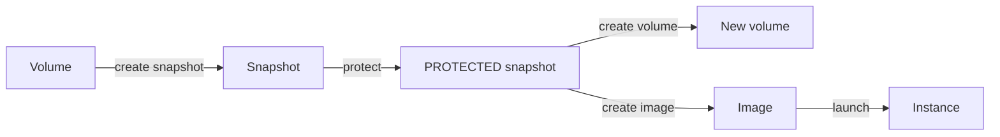

# Snapshots

A snapshot is a point-in-time copy of a volume's data. Snapshots let you reuse that data: as the starting point of a new volume, or as the source of an image that you launch instances from. A snapshot depends on its volume's stored data, so a volume can't be deleted while any of its snapshots exists.

The following diagram shows the path from a volume to a usable clone source and what you can create from it.

## Key concepts

**Snapshot states**  
A snapshot reports a `state` for the copy itself and a `protectionState`. Only a snapshot that is `COMPLETED` and `PROTECTED` can be used as a clone source. See [Snapshot states](snapshot-states.md).

**Protection**  
An explicit step after creation that makes a snapshot usable as a clone source. A protected snapshot can't be deleted until you unprotect it, and a snapshot an image is built from, or a volume was created from, can't be unprotected until that image or volume is deleted. See [Create and protect a snapshot](create-and-protect.md).

**Crash consistency**  
A snapshot of an attached volume is taken while the instance runs. It captures the disk as a sudden power-off would.

## What you can do

- [Create and protect a snapshot](create-and-protect.md)
- [Create a volume from a snapshot](../volumes/create.md#create-a-volume-from-a-snapshot)
- [Create an image](../../compute/images/create.md) from a protected snapshot (a compute operation)
- [Delete a snapshot](delete.md)

## Limits and quotas

The number of snapshots is capped per organization and, where set, per project. Completed snapshots are billed for the size of the volume they were taken from. See [Limits](../../platform/reference/limits.md#storage) and [Pricing](../../pricing/index.md).

## Related

- [Volumes](../volumes/index.md)
- [`origin pvs` commands](../reference/cli.md)
- [Troubleshoot storage](../troubleshooting/index.md)
