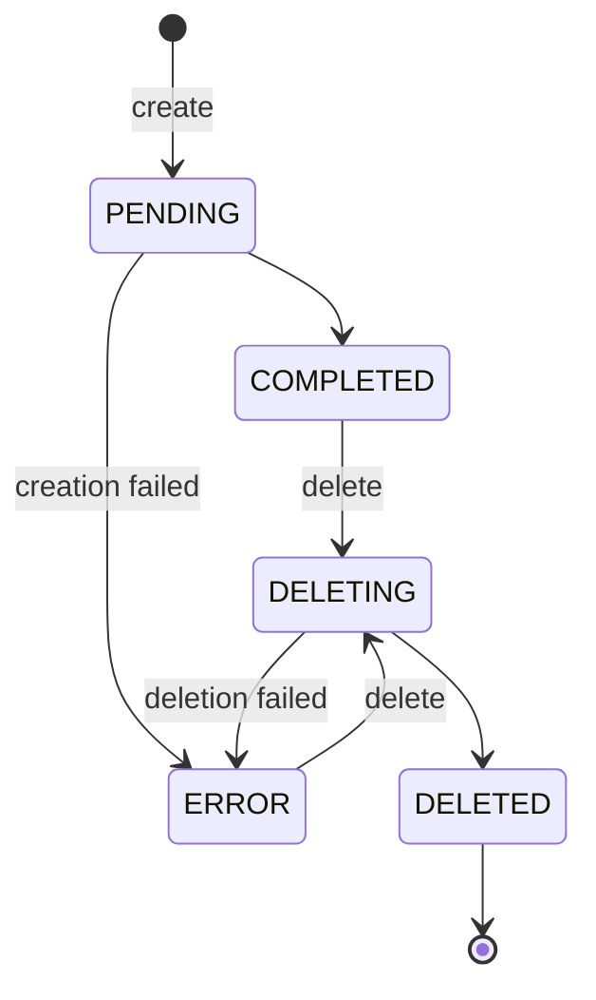
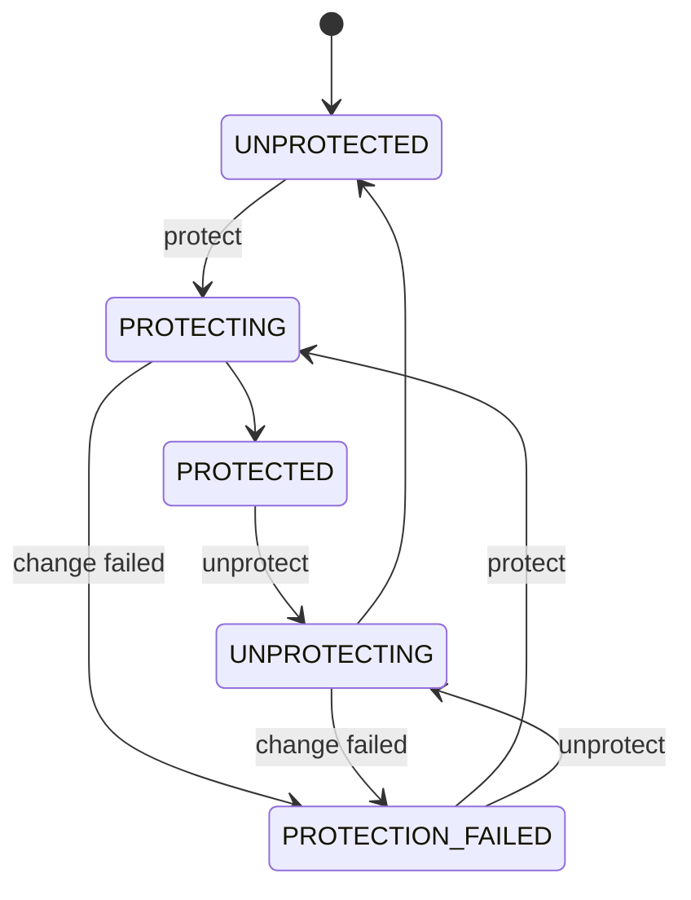

# Snapshot states

A snapshot reports two independent fields: `state` describes the copy itself, and `protectionState` describes whether it's protected. A snapshot is usable as a clone source only when it reports `state: COMPLETED` and `protectionState: PROTECTED`. Creating, protecting, unprotecting, and deleting a snapshot are long-running operations. The `origin pvs` commands wait until the operation is done, and these fields tell you how the work ended.

This page uses the field names the CLI prints. The GraphQL API names some of them differently; see [Field names in the GraphQL API](#field-names-in-the-graphql-api).

## State

The following diagram shows the `state` values and what moves a snapshot between them.

| State | Meaning | Billed |
|---|---|---|
| `PENDING` | The platform is copying the volume's data. | No |
| `COMPLETED` | The copy is finished. | Yes |
| `ERROR` | Creating or deleting the snapshot failed. `stateReason` says what failed. | No |
| `DELETING` | The platform is removing the snapshot. | No |
| `DELETED` | The snapshot is gone. | No |

`sourceVolume` names the volume the snapshot was taken from, and `sourceSizeGib` its size at the time: the smallest size a volume created from the snapshot can have.

## When an operation fails

- **A snapshot that couldn't be created** ends in `ERROR` instead of `COMPLETED`. There's no usable snapshot behind it. Delete it and take a new one.
- **A snapshot that couldn't be deleted** stays in your list as `ERROR` instead of reaching `DELETED`. Its copy may still exist, and it still blocks deleting the volume it was taken from. Delete it again once the cause is resolved.

`stateReason` is empty for every state except `ERROR`.

## Protection state

The following diagram shows the `protectionState` values. A new snapshot starts `UNPROTECTED`.

| Value | Clone source | Deletable |
|---|---|---|
| `UNPROTECTED` | No | Yes |
| `PROTECTING` | No | No |
| `PROTECTED` | Yes, if `COMPLETED` | No |
| `UNPROTECTING` | No | No |
| `PROTECTION_FAILED` | No | No |

`PROTECTION_FAILED` means the last protect or unprotect couldn't be applied, so the snapshot's real protection state is unknown. The platform treats it as neither protected nor unprotected. `protectionReason` says why the change failed, and the snapshot's data is unaffected. To settle the state, protect the snapshot again, or unprotect it, which is also the way to get it to a state you can delete.

Which state a protect or unprotect needs:

- **Protect** needs `state: COMPLETED`. A `PENDING` snapshot has no finished copy yet; a `DELETING`, `DELETED`, or `ERROR` snapshot has nothing to protect.
- **Unprotect** works on a `COMPLETED` snapshot and on an `ERROR` snapshot. Unprotecting an `ERROR` snapshot lets you delete it.

While an image is built from a snapshot, unprotecting the snapshot is refused with a `CONFLICT` that names the image, whatever the snapshot's state, `ERROR` included. Delete the image first. The same holds while a volume created from the snapshot exists: the `CONFLICT` names the volume, and the volume has to report `DELETED` first.

Asking for the protection state a snapshot already has succeeds and changes nothing. A refused protect or unprotect changes nothing about the snapshot.

## Clone sources

A snapshot can be the source of a new volume, an image, or an instance's volume launched from that image. Every one of those paths checks the same rule at the moment of use: `state: COMPLETED` and `protectionState: PROTECTED`. A snapshot an image is built from keeps passing it: it can't be unprotected or deleted until the image is deleted. A snapshot a volume was created from can't be unprotected until the volume is deleted.

## Settled states

A `COMPLETED` snapshot stays usable as a clone source as long as it stays protected, and a `DELETED` snapshot stays gone. A deleted snapshot drops out of your snapshot list immediately. For 24 hours you can still look it up by its name with `origin pvs get-snapshot`, or by its URN with the `pvs.snapshot` query; after that the lookup finds nothing.

In the GraphQL API, a change of state can take a few seconds to show in a list or a lookup. To read your own change at once, send back the token its response carried; see [Read what you just changed](../../platform/access/api.md#read-what-you-just-changed).

## Field names in the GraphQL API

The GraphQL API's `PvsSnapshot` reports the same states under these names:

| CLI output | GraphQL API |
|---|---|
| `state` | `status` |
| `stateReason` | `statusReason` |
| `protectionState` | `protectionStatus` |
| `PROTECTION_FAILED` | `FAILED` |
| `protectionReason` | `protectionStatusReason` |
| `sourceVolume` | `volumeUrn` |
| `sourceSizeGib` | `volumeSizeInGib` |

The GraphQL API also reports a copy's progress: while a snapshot is `PENDING`, `progress` reports `PENDING` and `percentComplete` shows how far the copy has got. `progress` is `AVAILABLE` once the data is fully copied, and `UNAVAILABLE` when no progress information exists. The CLI doesn't show progress.

## Related

- [Create and protect a snapshot](create-and-protect.md)
- [Delete a snapshot](delete.md)
- [Volume states](../volumes/volume-states.md)
