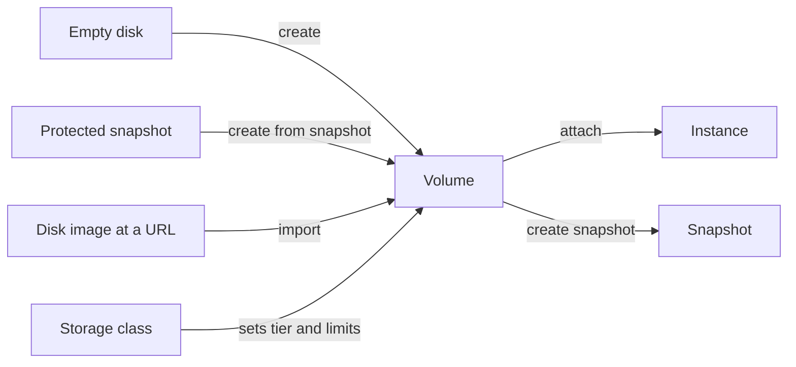

# Volumes

A volume is a durable block disk. Its data lives in durable storage, not on the machine that runs your instance, so it survives instance stops and host failures. You can create a volume on its own, attach it to an instance, grow it, snapshot it, and delete it when you no longer need it. Every volume you create yourself is a durable volume of this kind.

The following diagram shows a volume in context: where its content comes from and what it connects to.

## Key concepts

**Storage class**  
The performance tier of a volume. `gp1` is the default and the tier you can select. See [Storage classes](storage-classes.md).

**Performance limits**  
Every volume has an IOPS and a throughput limit, set from its storage class when it is created and shown in its `iops` and `throughputMibps` fields. A `gp1` volume is limited to 3,000 IOPS and 125 MiB/s. See [Performance limits](storage-classes.md#performance-limits).

**Volume states**  
A volume reports a `state` (such as `AVAILABLE` or `IN_USE`) and a separate `resizeState` for resizes. Volume operations are long-running operations, and failures show up in these fields. See [Volume states](volume-states.md).

**Attachment**  
While a volume is attached to an instance, it reports `IN_USE` and names the volume attachment in `attachment`. See [Find the instance a volume is attached to](find-instance.md).

## What you can do

- [Create a volume](create.md)
- [Import a disk image as a volume](import.md)
- [Resize a volume](resize.md)
- [Find the instance a volume is attached to](find-instance.md)
- [Delete a volume](delete.md)
- [Attach and detach volumes](../../compute/instance-storage/attach-detach.md) (a compute operation)

## Limits and quotas

Provisioned volume storage is capped per organization and per project. Creating, importing, and growing a volume all count against the same cap. See [Limits](../../platform/reference/limits.md#storage).

## Related

- [Snapshots](../snapshots/index.md) – point-in-time copies of a volume.
- [`origin pvs` commands](../reference/cli.md)
- [Troubleshoot storage](../troubleshooting/index.md)
