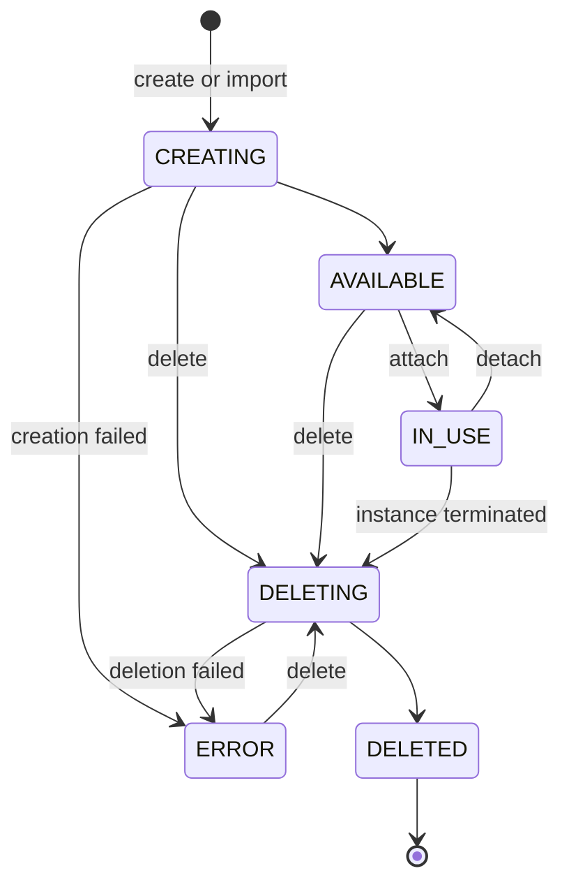
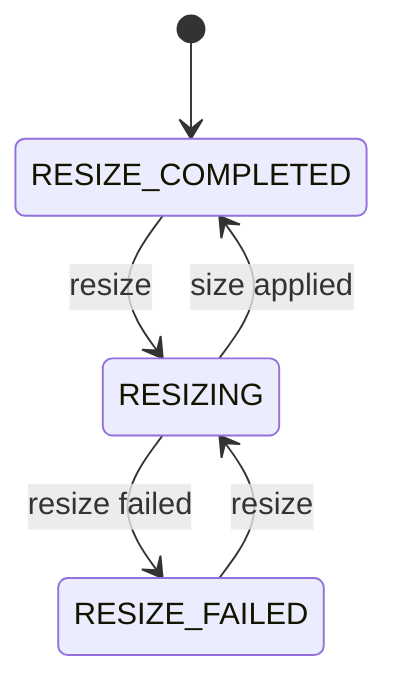

# Volume states

A volume reports two independent fields: `state` describes the volume itself, and `resizeState` describes the last resize. Creating, importing, resizing, and deleting a volume are long-running operations. The `origin pvs` commands wait until the operation is done; these fields tell you how the work ended, and where a volume is while it runs.

This page uses the field names the CLI prints. The GraphQL API names some of them differently; see [Field names in the GraphQL API](#field-names-in-the-graphql-api).

## State

The following diagram shows the `state` values and what moves a volume between them.

| State | Meaning | Billed | Counts against quota |
|---|---|---|---|
| `CREATING` | The platform is provisioning the volume. | No | Yes |
| `AVAILABLE` | The volume exists and isn't attached to an instance. | Yes | Yes |
| `IN_USE` | The volume is attached to an instance. `attachment` names the volume attachment. | Yes | Yes |
| `DELETING` | The platform is removing the volume. | No | Yes |
| `DELETED` | The volume is gone. | No | No |
| `ERROR` | Creating or deleting the volume failed. `stateReason` says what failed. | No | Yes |

An `IN_USE` volume moves to `DELETING` only when the instance it's attached to is terminated and the volume is set to be deleted with it. A delete you request yourself is refused while the volume is attached. See [Delete a volume](delete.md).

To see which instance holds an `IN_USE` volume, see [Find the instance a volume is attached to](find-instance.md).

## When an operation fails

A failed operation never reports success: the command that waited for it fails, and the volume tells you what happened:

- **A volume that couldn't be created** ends in `ERROR` instead of `AVAILABLE`. It has no usable disk behind it. Delete it and create a new one.
- **A volume that couldn't be deleted** stays in your volume list as `ERROR` instead of reaching `DELETED`. Its disk may still exist, so it still counts against your quota. Delete it again once the cause is resolved.

`stateReason` is empty for every state except `ERROR`. When set, it has the form `the operation failed (<code>)`, for example `the operation failed (ERR_IMPORT)`. For the codes an import can report, see [Import a disk image as a volume](import.md).

Requests the platform can tell are invalid up front, such as deleting an attached volume or shrinking a volume, are refused immediately with an error. They never reach `ERROR`, and nothing about the volume changes.

## Resize state

The following diagram shows how `resizeState` tracks a resize.

| Value | Meaning |
|---|---|
| `RESIZE_COMPLETED` | No resize is in progress. The last resize, if any, was applied. |
| `RESIZING` | A resize is in progress. `pendingSizeGib` shows the target size. |
| `RESIZE_FAILED` | The last resize wasn't applied. `resizeReason` says why. |

`sizeGib` changes only after the platform confirms the new size, so it's always a size the disk really has. While a resize runs, compare `sizeGib` with `pendingSizeGib` to tell "still in progress" from "didn't happen". A failed resize leaves the volume's data and `sizeGib` untouched. For details, see [Resize a volume](resize.md).

## Settled states

A state that has settled stays settled. Only something you do next changes it:

- A `DELETED` volume never reappears in your list and never returns to `ERROR`.
- An `ERROR` volume leaves that state only through another delete.
- A `RESIZE_FAILED` volume keeps its `resizeReason` until you request another resize.

## Deleted volumes

A deleted volume drops out of your volume list immediately. For 24 hours you can still look it up by its name with `origin pvs get-volume`, or by its URN with the `pvs.volume` query, and it reports `DELETED`; after that the lookup finds nothing.

In the GraphQL API, a change of state can take a few seconds to show in a list or a lookup. To read your own change at once, send back the token its response carried; see [Read what you just changed](../../platform/access/api.md#read-what-you-just-changed).

## A volume that outlived its instance

When you terminate an instance, the volumes created with it are normally deleted too. If one of them can't be deleted, most often because a snapshot of it still exists, the platform keeps the volume instead of failing the termination. The volume is `AVAILABLE`, it's yours, and it's billed.

`retentionNote` on the volume explains why it was kept. It's empty on every other volume, including volumes you created yourself. To remove a kept volume, delete its snapshots and then the volume. See [Delete a volume](delete.md).

## Field names in the GraphQL API

The GraphQL API's `PvsVolume` reports the same states under these names:

| CLI output | GraphQL API |
|---|---|
| `state` | `status` |
| `IN_USE` | `INUSE` |
| `stateReason` | `statusReason` |
| `attachment` | `claimRef` |
| `resizeState` | `modificationStatus` |
| `RESIZE_COMPLETED`, `RESIZING`, `RESIZE_FAILED` | `COMPLETED`, `RESIZING` or `MODIFYING`, `FAILED` |
| `resizeReason` | `modificationStatusReason` |
| `sizeGib`, `pendingSizeGib` | `sizeInGib`, `pendingSizeInGib` |

Where the CLI prints an empty string or `0` for a field that isn't set, the GraphQL API returns `null`.

## Related

- [Snapshot states](../snapshots/snapshot-states.md)
- [Troubleshoot storage](../troubleshooting/index.md)
- [Storage reference](../reference/index.md)
